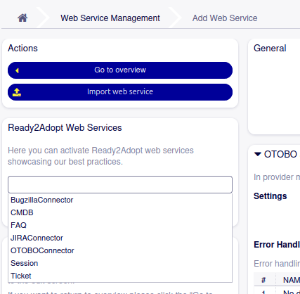
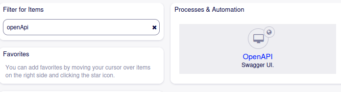
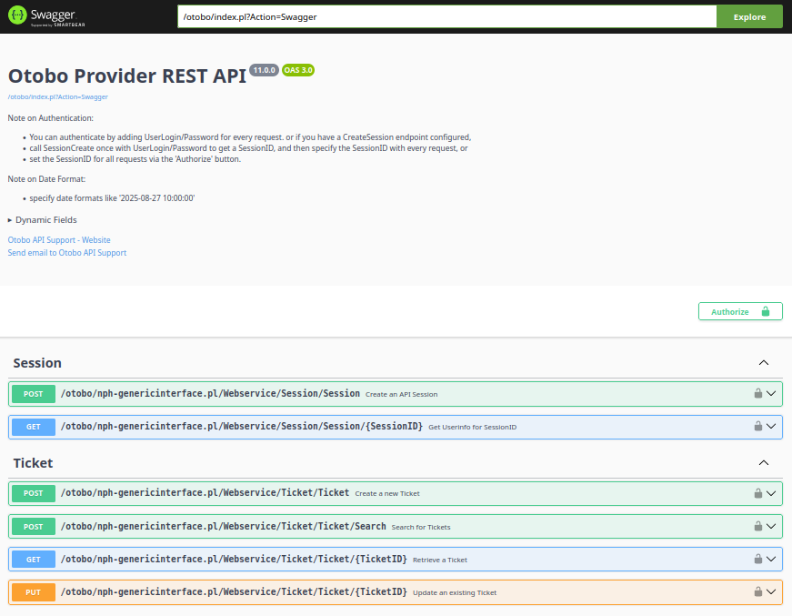

.. image:: ../images/otobo-logo.png
   :align: center

.. toctree::
    :maxdepth: 2
    :caption: Contents

Sacrifice to Sphinx
===================
.. This chapter must always be empty. Any content is lost when creating the final version of the documentation.

Overview
========
The Otobo WebService-OpenAPI is the "WebService Getting Starting" package for Otobo. 

Summary
-------

This package adds support for automatic generation of an OpenAPI specification document describing the available Otobo WebService operations, and bundles the well well-known
Swagger UI to interacively explore and try out the available WebService operation endpoints.

In addition this packages adds "ready2adopt" WebService Operation configuration to quickly setup API endpoints. Ready2adopt 
WebService Operations include:

- Ticket Service
- Session Service
- FAQ Service (with FAQ module)
- CMDB Service (with ITSMConfigurationManagement module)

Introduction
------------

Use this package if

- you want to get started with WebService operations provided by Otobo

- you want to quickly configure your Otobo instance with a basic set of reasonable API endpoints provided by the "ready2adopt" WebServices

- you want to explore the available API Endpoints, vie HTTP Methods, Paths and Parameters

- you want to try out the API endpoints interactively with a nice browser based UI provided by the de-facto industry standard

Configuration
=============

In order to make use of the bundled Swagger UI you need to configure Otobo WebService Operations first.

This packages makes it easy by providing "ready2adopt" WebService operation definitions.

To activate, navigate the Admin UI and got to:

Admin UI > Web Services -> Add New

For starters, choose "Ticket" and click the import ready2adopt webservice button:

As you are here, you probably want to do the same for the "Session" Service.

You can also import ready2adopt definitions for FAQ and CMDB services, but please note you need to install the relevant Otobo packages beforehand 
(FAQ packages and ITSMConfigurationManagement package, respectively).

Visit the Swagger UI
--------------------

With at least one Operation service configured, visit the Swagger UI bundled with Otobo. To do so, navigate to "Open API" in the Admin UI:

Admin UI > Open API

This will give you the intercative API documentation provided by Swagger UI:

Admin UI > Open API

System requirements
-------------------

Framework
^^^^^^^^^

OTOBO 11.0.x

Packages
^^^^^^^^

This package does not depend on other Otobo packages.

Third-party software
^^^^^^^^^^^^^^^^^^^^

This package bundles the Swagger UI available on `GitHub <https://github.com/swagger-api/swagger-ui>`__  

Further Reading
---------------

Learn about te Open API spec at the OpenAPI `website <https://swagger.io/resources/open-api/>`__  

About
=======

Contact
-------
| Rother OSS GmbH
| Email: hello@otobo.io
| Web: https://otobo.io

Version
-------
